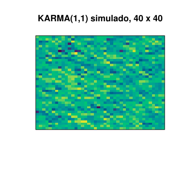
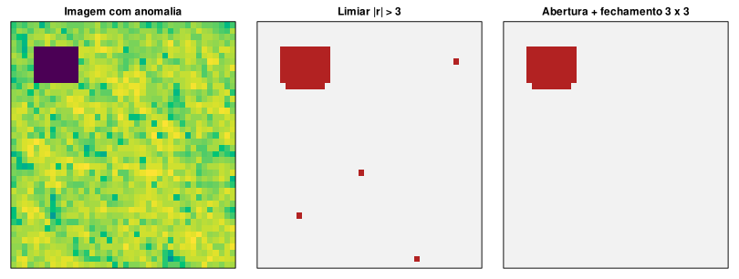
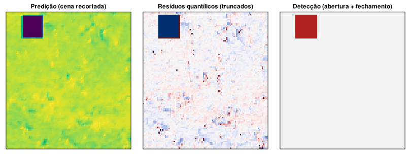
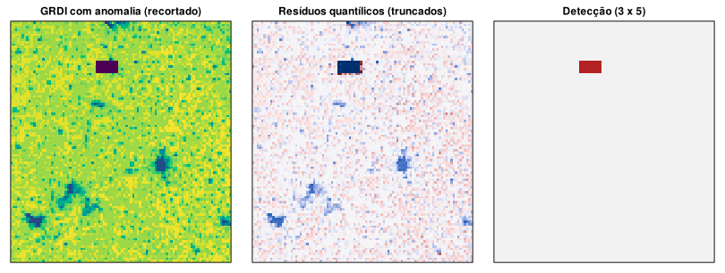

Relatório de uso do pacote karma2d
================

- **Data de geração:** 2026-11-25
- **Versão do R:** R version 4.3.3 (2024-02-29)
- **Versão do pacote karma2d:** 0.1.0.9000
- **Plataforma:** x86_64-pc-linux-gnu

Todos os resultados abaixo foram produzidos executando o código no
momento da renderização deste documento: nenhuma saída foi copiada ou
editada à mão. Toda geração aleatória usa `set.seed()` ou o argumento
`seed=` das funções do pacote, de modo que o relatório é reprodutível.

## Infraestrutura de verificação

Um bloco de configuração oculto define duas tabelas globais e três
funções auxiliares:

- `tm(fun, expr)` avalia `expr` dentro de `system.time()`, registra o
  tempo decorrido (segundos) sob o nome da função `fun` e devolve o
  valor;
- `check(fun, what, ok, expected, observed)` registra uma verificação:
  nome da função, o que foi verificado, o valor esperado, o valor
  observado, o status (`OK`/`FAIL`) e o tempo da última chamada
  cronometrada. A condição `ok` é sempre calculada a partir das saídas
  das funções (não é uma reafirmação);
- `show_img()`/`show_mask()` desenham matrizes com a linha 1 no topo.

Cada verificação é impressa no momento em que é feita, e a seção final
reúne a tabela completa e um resumo por função. Um `FAIL` nunca é
ocultado.

## 1. Distribuição Kumaraswamy

`dkuma()`, `pkuma()`, `qkuma()` e `rkuma()` implementam a distribuição
Kumaraswamy parametrizada pela **mediana** e por um parâmetro de forma,
em um suporte limitado `(lower, upper)`. É a distribuição condicional de
cada pixel no modelo 2-D KARMA.

``` r
m <- 0.3; s <- 4
tm("dkuma", d <- dkuma(c(0.1, 0.3, 0.6), median = m, shape = s))
d
#> [1] 0.3380473021 4.6398234316 0.0006163264
tm("pkuma", p_med <- pkuma(m, median = m, shape = s))
p_med
#> [1] 0.5
check("pkuma", "propriedade da mediana: pkuma(m, m, s) == 0.5",
      abs(p_med - 0.5) < 1e-12, 0.5, p_med)
#> [OK] pkuma: propriedade da mediana: pkuma(m, m, s) == 0.5 (esperado:     0.5; observado:     0.5)

pp <- c(0.001, 0.1, 0.5, 0.9, 0.999)
tm("qkuma", qq <- qkuma(pp, median = m, shape = s))
qq
#> [1] 0.05853421 0.18748152 0.30000000 0.40406074 0.52822631
err_inv <- max(abs(pkuma(qq, m, s) - pp))
check("qkuma", "inversa: max |pkuma(qkuma(p)) - p|", err_inv < 1e-12,
      "< 1e-12", err_inv)
#> [OK] qkuma: inversa: max |pkuma(qkuma(p)) - p| (esperado: < 1e-12; observado: 1.66533e-16)

tm("dkuma", integ <- integrate(dkuma, 0, 1, median = m, shape = s)$value)
check("dkuma", "densidade integra 1 em (0, 1)", abs(integ - 1) < 1e-6,
      1, integ)
#> [OK] dkuma: densidade integra 1 em (0, 1) (esperado:       1; observado:       1)

# General support (-1, 1): median and quantiles on the original scale
m_g <- 0.4
gen <- c(p = pkuma(m_g, m_g, 5, lower = -1, upper = 1),
         q = qkuma(0.5, m_g, 5, lower = -1, upper = 1),
         int = integrate(dkuma, -1, 1, median = m_g, shape = 5,
                         lower = -1, upper = 1)$value)
gen
#>   p   q int 
#> 0.5 0.4 1.0
check("pkuma", "suporte (-1, 1): F(mediana) = 0.5 e Q(0.5) = mediana",
      abs(gen[["p"]] - 0.5) < 1e-12 && abs(gen[["q"]] - m_g) < 1e-12,
      c(0.5, m_g), gen[c("p", "q")])
#> [OK] pkuma: suporte (-1, 1): F(mediana) = 0.5 e Q(0.5) = mediana (esperado:     0.5,     0.4; observado:     0.5,     0.4)

x <- c(0.05, 0.5, 0.95)
log_ok <- max(abs(dkuma(x, m, s, log = TRUE) - log(dkuma(x, m, s))))
tail_ok <- max(abs(pkuma(x, m, s, lower.tail = FALSE) - (1 - pkuma(x, m, s))))
check("dkuma", "log = TRUE igual a log(densidade); lower.tail = FALSE igual a 1 - F",
      log_ok < 1e-12 && tail_ok < 1e-12, "< 1e-12", c(log_ok, tail_ok))
#> [OK] dkuma: log = TRUE igual a log(densidade); lower.tail = FALSE igual a 1 - F (esperado: < 1e-12; observado:       0, 1.9082e-17)

n <- 1e4
tm("rkuma", r <- { set.seed(101); rkuma(n, median = m, shape = s) })
se_med <- 1 / (2 * dkuma(m, m, s) * sqrt(n))   # asymptotic SE of the median
tol <- 4 * se_med
c(sample_median = median(r), tolerance = tol)
#> sample_median     tolerance 
#>   0.299444449   0.004310509
check("rkuma", "mediana amostral (n = 1e4) a menos de 4 EP assintóticos",
      abs(median(r) - m) < tol, sprintf("%g +/- %.4f", m, tol), median(r))
#> [OK] rkuma: mediana amostral (n = 1e4) a menos de 4 EP assintóticos (esperado: 0.3 +/- 0.0043; observado: 0.299444)
```

A tolerância para `rkuma()` é de quatro erros-padrão assintóticos da
mediana amostral, $1/\{2 f(m)\sqrt{n}\}$, isto é, cerca de 0.0043 para
$n = 10^4$: uma amostra correta só falharia com probabilidade da ordem
de $6\times10^{-5}$.

## 2. Estrutura de defasagens

`karma2d_lags()` lista as defasagens espaciais (linha, coluna) dos
coeficientes de um modelo isotrópico de ordem `p`, na ordem em que os
coeficientes são guardados em todo o pacote.

``` r
tm("karma2d_lags", l1 <- karma2d_lags(1))
l1
#>   row_lag col_lag     name
#> 1       0       1 phi(0,1)
#> 2       1       0 phi(1,0)
#> 3       1       1 phi(1,1)
tm("karma2d_lags", l2 <- karma2d_lags(2))
nrow(l2)
#> [1] 8
check("karma2d_lags", "número de coeficientes (p+1)^2 - 1 para p = 1, 2",
      nrow(l1) == 3 && nrow(l2) == 8, c(3, 8), c(nrow(l1), nrow(l2)))
#> [OK] karma2d_lags: número de coeficientes (p+1)^2 - 1 para p = 1, 2 (esperado:       3,       8; observado:       3,       8)
ord <- paste0("(", l1$row_lag, ",", l1$col_lag, ")")
check("karma2d_lags", "ordem (0,1), (1,0), (1,1) para p = 1",
      identical(ord, c("(0,1)", "(1,0)", "(1,1)")),
      "(0,1), (1,0), (1,1)", ord)
#> [OK] karma2d_lags: ordem (0,1), (1,0), (1,1) para p = 1 (esperado: (0,1), (1,0), (1,1); observado: (0,1), (1,0), (1,1))
```

## 3. Simulação

`karma2d_simulate()` gera uma imagem de um modelo 2-D KARMA pelo método
da inversão. Usamos os valores do artigo para KARMA(1,0), KARMA(0,1) e
KARMA(1,1).

``` r
tm("karma2d_simulate", y_ar <- karma2d_simulate(
  40, 40, alpha = 0.6609, ar = c(0.2819, 0.1897, 0.1653),
  shape = 19.6065, seed = 11))
tm("karma2d_simulate", y_ma <- karma2d_simulate(
  40, 40, alpha = 1.1114, ma = c(0.3467, 0.2819, 0.1848),
  shape = 12.3857, seed = 12))
tm("karma2d_simulate", y_arma <- karma2d_simulate(
  40, 40, alpha = 0.3, ar = c(0.3, -0.15, 0.23), ma = c(0.15, -0.1, 0.25),
  shape = 17, seed = 13))
sapply(list(AR = y_ar, MA = y_ma, ARMA = y_arma), range)
#>             AR        MA      ARMA
#> [1,] 0.5412388 0.4097694 0.3789587
#> [2,] 0.9695446 0.9239835 0.7668056
attr(y_arma, "karma2d")$parameters
#>      alpha   phi(0,1)   phi(1,0)   phi(1,1) theta(0,1) theta(1,0) theta(1,1)      shape 
#>       0.30       0.30      -0.15       0.23       0.15      -0.10       0.25      17.00

y_again <- karma2d_simulate(
  40, 40, alpha = 0.3, ar = c(0.3, -0.15, 0.23), ma = c(0.15, -0.1, 0.25),
  shape = 17, seed = 13)
check("karma2d_simulate", "mesma semente gera imagem idêntica",
      identical(y_again, y_arma), TRUE, identical(y_again, y_arma))
#> [OK] karma2d_simulate: mesma semente gera imagem idêntica (esperado: TRUE; observado: TRUE)

set.seed(999)
before <- .Random.seed
invisible(karma2d_simulate(10, 10, alpha = 0.3, ar = c(0.3, -0.15, 0.23),
                           shape = 17, seed = 1))
check("karma2d_simulate", ".Random.seed global inalterado após seed =",
      identical(before, .Random.seed), TRUE, identical(before, .Random.seed))
#> [OK] karma2d_simulate: .Random.seed global inalterado após seed = (esperado: TRUE; observado: TRUE)

all_in <- all(sapply(list(y_ar, y_ma, y_arma),
                     function(v) all(v > 0 & v < 1)))
check("karma2d_simulate", "valores estritamente em (0, 1) nos três modelos",
      all_in, TRUE, all_in)
#> [OK] karma2d_simulate: valores estritamente em (0, 1) nos três modelos (esperado: TRUE; observado: TRUE)

tm("karma2d_simulate", y_pm <- karma2d_simulate(
  40, 40, alpha = 0.3, ar = c(0.3, -0.15, 0.23), ma = c(0.15, -0.1, 0.25),
  shape = 17, seed = 13, lower = -1, upper = 1))
range(y_pm)
#> [1] -0.2420825  0.5336112
dev_pm <- max(abs(y_pm - (2 * y_arma - 1)))
check("karma2d_simulate",
      "suporte (-1, 1): valores em (-1, 1) e iguais a 2*y - 1 (mesma semente)",
      all(y_pm > -1 & y_pm < 1) && dev_pm < 1e-12, "< 1e-12", dev_pm)
#> [OK] karma2d_simulate: suporte (-1, 1): valores em (-1, 1) e iguais a 2*y - 1 (mesma semente) (esperado: < 1e-12; observado:       0)
```

``` r
show_img(y_arma, "KARMA(1,1) simulado, 40 x 40")
```



## 4. Ajuste

`karma2d_start()` calcula os valores iniciais do artigo,
`karma2d_control()` define as opções do otimizador e `karma2d_fit()`
ajusta o modelo por máxima verossimilhança condicional (BFGS com escore
analítico). Ajustamos um KARMA(1,1) à imagem 40 x 40 simulada acima.

``` r
truth <- c(0.3, 0.3, -0.15, 0.23, 0.15, -0.1, 0.25, 17)
tm("karma2d_start", st <- karma2d_start(y_arma, order = c(1, 1)))
st
#>      alpha   phi(0,1)   phi(1,0)   phi(1,1) theta(0,1) theta(1,0) theta(1,1)      shape 
#>  0.4346948  0.0000000  0.0000000  0.0000000  0.0000000  0.0000000  0.0000000 24.8871029
z_bar <- mean(y_arma)
st_hand <- c(qlogis(z_bar), rep(0, 6),
             0.3 * (z_bar * (1 - z_bar) / var(as.vector(y_arma)) - 1))
check("karma2d_start", "valores iniciais = (g(ȳ), 0, ..., 0, 0.3{ȳ(1-ȳ)/S² - 1})",
      max(abs(unname(st) - st_hand)) < 1e-12, "< 1e-12",
      max(abs(unname(st) - st_hand)))
#> [OK] karma2d_start: valores iniciais = (g(ȳ), 0, ..., 0, 0.3{ȳ(1-ȳ)/S² - 1}) (esperado: < 1e-12; observado:       0)

tm("karma2d_control", ctl <- karma2d_control())
str(unclass(ctl))
#> List of 5
#>  $ shape_transform: chr "log"
#>  $ maxit          : int 500
#>  $ reltol         : num 1e-10
#>  $ information    : chr "expected"
#>  $ trace          : int 0
check("karma2d_control", "valores padrão (log, maxit 500, reltol 1e-10, expected)",
      identical(ctl$shape_transform, "log") && ctl$maxit == 500L &&
        ctl$reltol == 1e-10 && identical(ctl$information, "expected"),
      "log, 500, 1e-10, expected",
      c(ctl$shape_transform, ctl$maxit, ctl$reltol, ctl$information))
#> [OK] karma2d_control: valores padrão (log, maxit 500, reltol 1e-10, expected) (esperado: log, 500, 1e-10, expected; observado: log, 500, 1e-10, expected)

tm("karma2d_fit", fit <- karma2d_fit(y_arma, order = c(1, 1)))
fit
#> 2-D KARMA(1, 1) model with logit link
#> Image: 40 x 40, effective region: 1521 pixels
#> 
#> Coefficients:
#>      alpha   phi(0,1)   phi(1,0)   phi(1,1) theta(0,1) theta(1,0) theta(1,1)      shape 
#>     0.3225     0.2833    -0.1490     0.2028     0.1422    -0.1039     0.2630    16.7119 
#> 
#> Log-likelihood: 2639
check("karma2d_fit", "código de convergência do BFGS", fit$convergence == 0,
      0, fit$convergence)
#> [OK] karma2d_fit: código de convergência do BFGS (esperado:       0; observado:       0)
z_err <- abs(coef(fit) - truth) / sqrt(diag(vcov(fit)))
round(z_err, 2)
#>      alpha   phi(0,1)   phi(1,0)   phi(1,1) theta(0,1) theta(1,0) theta(1,1)      shape 
#>       0.85       0.45       0.02       0.80       0.20       0.09       0.31       0.86
check("karma2d_fit", "|estimativa - verdade| < 4 EP para todos os parâmetros",
      all(z_err < 4), "< 4", max(z_err))
#> [OK] karma2d_fit: |estimativa - verdade| < 4 EP para todos os parâmetros (esperado: < 4; observado: 0.861467)

tm("karma2d_score", sc <- karma2d_score(y_arma, coef(fit), order = c(1, 1)))
sc_rel <- max(abs(sc)) / nobs(fit)
check("karma2d_score", "escore na estimativa ≈ 0 (max |U| / nobs)",
      sc_rel < 1e-4, "< 1e-4", sc_rel)
#> [OK] karma2d_score: escore na estimativa ≈ 0 (max |U| / nobs) (esperado: < 1e-4; observado: 1.72694e-05)

tm("karma2d_fit", fit_obs <- karma2d_fit(
  y_arma, order = c(1, 1), control = karma2d_control(information = "observed")))
rbind(expected = sqrt(diag(vcov(fit))), observed = sqrt(diag(vcov(fit_obs))))
#>               alpha   phi(0,1)   phi(1,0)   phi(1,1) theta(0,1) theta(1,0) theta(1,1)
#> expected 0.02640323 0.03732207 0.04320441 0.03400269 0.03817084 0.04345485 0.04206171
#> observed 0.02490311 0.03730657 0.04023039 0.03251215 0.03866563 0.04112683 0.03826189
#>              shape
#> expected 0.3344424
#> observed 0.3374347
check("karma2d_fit",
      "information = 'observed': mesmas estimativas, inferência 'observed'/'ok'",
      max(abs(coef(fit_obs) - coef(fit))) < 1e-12 &&
        fit_obs$inference$type == "observed" &&
        fit_obs$inference$status == "ok",
      "diferença 0; observed; ok",
      c(max(abs(coef(fit_obs) - coef(fit))), fit_obs$inference$type,
        fit_obs$inference$status))
#> [OK] karma2d_fit: information = 'observed': mesmas estimativas, inferência 'observed'/'ok' (esperado: diferença 0; observed; ok; observado: 0, observed, ok)

tm("karma2d_fit", fit_id <- karma2d_fit(
  y_arma, order = c(1, 1),
  control = karma2d_control(shape_transform = "identity")))
dll <- abs(as.numeric(logLik(fit_id)) - as.numeric(logLik(fit)))
check("karma2d_control",
      "shape_transform = 'identity' atinge a mesma log-verossimilhança",
      dll < 1e-6, "< 1e-6", dll)
#> [OK] karma2d_control: shape_transform = 'identity' atinge a mesma log-verossimilhança (esperado: < 1e-6; observado: 5.70062e-07)
```

**Recomendação de múltiplos pontos de partida em imagens pequenas.** Em
imagens pequenas a verossimilhança condicional pode ter vários máximos
locais. A documentação de `karma2d_fit()` recomenda comparar ajustes com
diferentes transformações do parâmetro de forma (ou diferentes `start`)
e guardar o de maior log-verossimilhança. Num estudo preliminar das
sementes 1 a 5, a semente 5 foi a única em que as duas transformações
chegaram a máximos diferentes; ela foi escolhida aqui por ilustrar o
caso.

``` r
y10 <- karma2d_simulate(10, 10, alpha = 0.3, ar = c(0.3, -0.15, 0.23),
                        ma = c(0.15, -0.1, 0.25), shape = 17, seed = 5)
tm("karma2d_fit", fits10 <- list(
  log = karma2d_fit(y10, order = c(1, 1)),
  identity = karma2d_fit(y10, order = c(1, 1),
                         control = karma2d_control(shape_transform = "identity"))))
ll10 <- sapply(fits10, logLik)
ll10
#>      log identity 
#> 146.7402 146.7107
best10 <- fits10[[which.max(ll10)]]
names(fits10)[which.max(ll10)]
#> [1] "log"
check("karma2d_fit", "multi-start 10 x 10: ajuste mantido tem a maior log-verossimilhança",
      as.numeric(logLik(best10)) == max(ll10) && all(sapply(fits10, `[[`, "convergence") == 0),
      max(ll10), c(ll10, as.numeric(logLik(best10))))
#> [OK] karma2d_fit: multi-start 10 x 10: ajuste mantido tem a maior log-verossimilhança (esperado:  146.74; observado:  146.74, 146.711,  146.74)
```

## 5. Métodos S3

Os objetos `karma2d_fit` têm os métodos usuais de modelos estatísticos
do R.

``` r
print(fit, digits = 4)
#> 2-D KARMA(1, 1) model with logit link
#> Image: 40 x 40, effective region: 1521 pixels
#> 
#> Coefficients:
#>      alpha   phi(0,1)   phi(1,0)   phi(1,1) theta(0,1) theta(1,0) theta(1,1)      shape 
#>     0.3225     0.2833    -0.1490     0.2028     0.1422    -0.1039     0.2630    16.7119 
#> 
#> Log-likelihood: 2639
tm("summary", sm <- summary(fit))
sm
#> 2-D KARMA(1, 1) model with logit link
#> 
#> Call:
#> karma2d_fit(y = y_arma, order = c(1, 1))
#> 
#> Quantile residuals:
#>      Min       1Q   Median       3Q      Max 
#> -3.43165 -0.69944  0.01191  0.70116  3.28673 
#> 
#> Coefficients (expected information):
#>            Estimate Std. Error z value Pr(>|z|)    
#> alpha       0.32248    0.02640  12.214  < 2e-16 ***
#> phi(0,1)    0.28331    0.03732   7.591 3.18e-14 ***
#> phi(1,0)   -0.14897    0.04320  -3.448 0.000565 ***
#> phi(1,1)    0.20285    0.03400   5.966 2.44e-09 ***
#> theta(0,1)  0.14220    0.03817   3.725 0.000195 ***
#> theta(1,0) -0.10388    0.04345  -2.390 0.016826 *  
#> theta(1,1)  0.26304    0.04206   6.254 4.01e-10 ***
#> shape      16.71189    0.33444  49.969  < 2e-16 ***
#> ---
#> Signif. codes:  0 '***' 0.001 '**' 0.01 '*' 0.05 '.' 0.1 ' ' 1
#> 
#> Log-likelihood: 2639 on 8 parameters, 1521 pixels
#> AIC: -5262   BIC: -5219
coef(fit)
#>      alpha   phi(0,1)   phi(1,0)   phi(1,1) theta(0,1) theta(1,0) theta(1,1)      shape 
#>  0.3224841  0.2833090 -0.1489719  0.2028479  0.1421996 -0.1038784  0.2630355 16.7118890
round(vcov(fit)[1:3, 1:3], 6)
#>              alpha  phi(0,1)  phi(1,0)
#> alpha     0.000697 -0.000365 -0.000751
#> phi(0,1) -0.000365  0.001393 -0.000219
#> phi(1,0) -0.000751 -0.000219  0.001867
tm("confint", ci <- confint(fit))
round(ci, 4)
#>              2.5 %  97.5 %
#> alpha       0.2707  0.3742
#> phi(0,1)    0.2102  0.3565
#> phi(1,0)   -0.2337 -0.0643
#> phi(1,1)    0.1362  0.2695
#> theta(0,1)  0.0674  0.2170
#> theta(1,0) -0.1890 -0.0187
#> theta(1,1)  0.1806  0.3455
#> shape      16.0564 17.3674
half <- (ci[, 2] - ci[, 1]) / 2
d_half <- max(abs(half - qnorm(0.975) * sqrt(diag(vcov(fit)))))
check("confint", "meia-amplitude = qnorm(0.975) * EP", d_half < 1e-10,
      "< 1e-10", d_half)
#> [OK] confint: meia-amplitude = qnorm(0.975) * EP (esperado: < 1e-10; observado: 5.55112e-16)

c(logLik = logLik(fit), AIC = AIC(fit), BIC = BIC(fit), nobs = nobs(fit))
#>    logLik       AIC       BIC      nobs 
#>  2638.965 -5261.929 -5219.312  1521.000
k <- length(coef(fit))
d_ic <- max(abs(c(AIC(fit) - (-2 * fit$loglik + 2 * k),
                  BIC(fit) - (-2 * fit$loglik + log(nobs(fit)) * k))))
check("logLik, AIC, BIC, nobs", "AIC/BIC = -2 logLik + {2, log(nobs)} * k e nobs = 39^2",
      d_ic < 1e-8 && nobs(fit) == 39^2, c(0, 1521), c(d_ic, nobs(fit)))
#> [OK] logLik, AIC, BIC, nobs: AIC/BIC = -2 logLik + {2, log(nobs)} * k e nobs = 39^2 (esperado:       0,    1521; observado:       0,    1521)

tm("predict", pr_none <- predict(fit, padding = "none"))
f_hat <- fitted(fit)
same_na <- identical(is.na(pr_none), is.na(f_hat))
d_pf <- max(abs(pr_none - f_hat), na.rm = TRUE)
check("predict, fitted", "predict nos dados de treino = fitted (incl. posição dos NA)",
      same_na && d_pf < 1e-12, "< 1e-12; mesmos NA", c(d_pf, same_na))
#> [OK] predict, fitted: predict nos dados de treino = fitted (incl. posição dos NA) (esperado: < 1e-12; mesmos NA; observado:       0,       1)

tm("predict", pr_dup <- predict(fit, padding = "duplicate"))
c(NA_none = sum(is.na(pr_none)), NA_duplicate = sum(is.na(pr_dup)))
#>      NA_none NA_duplicate 
#>           79            0
# With an MA part the padded recursion also changes interior predictions,
# because border errors are no longer zero:
max(abs(pr_dup - pr_none), na.rm = TRUE)
#> [1] 0.05888334
check("predict", "padding = 'duplicate' sem NA", !anyNA(pr_dup), 0,
      sum(is.na(pr_dup)))
#> [OK] predict: padding = 'duplicate' sem NA (esperado:       0; observado:       0)

tm("predict", pr_link <- predict(fit, type = "link", padding = "duplicate"))
d_link <- max(abs(pr_link - qlogis(pr_dup)))
check("predict", "type = 'link' = qlogis(predição da mediana)", d_link < 1e-10,
      "< 1e-10", d_link)
#> [OK] predict: type = 'link' = qlogis(predição da mediana) (esperado: < 1e-10; observado: 5.55112e-16)

tm("residuals", rq <- residuals(fit))
rr <- residuals(fit, type = "response")
rl <- residuals(fit, type = "link")
summary(as.vector(rq))
#>     Min.  1st Qu.   Median     Mean  3rd Qu.     Max.     NA's 
#> -3.43165 -0.69944  0.01191 -0.00227  0.70116  3.28673       79
d_resp <- max(abs(rr - (y_arma - f_hat)), na.rm = TRUE)
eta_none <- predict(fit, type = "link", padding = "none")
d_lres <- max(abs(rl - (qlogis(y_arma) - eta_none)), na.rm = TRUE)
check("residuals", "response = y - fitted; link = g(y) - eta",
      d_resp < 1e-12 && d_lres < 1e-8, "< 1e-12, < 1e-8", c(d_resp, d_lres))
#> [OK] residuals: response = y - fitted; link = g(y) - eta (esperado: < 1e-12, < 1e-8; observado:       0, 5.55112e-16)
```

## 6. Inferência (ferramentas de pesquisa)

`karma2d_loglik()`, `karma2d_score()` e `karma2d_information()` avaliam
a log-verossimilhança condicional, o escore analítico e a informação
(esperada ou observada) em parâmetros arbitrários; `karma2d_fisher()`
faz o mesmo para um ajuste. Comparamos com derivadas numéricas de
`numDeriv`, avaliando em um ponto **diferente** da estimativa (a
verdade), onde o escore não é nulo.

``` r
ord11 <- c(1, 1)
tm("karma2d_loglik", ll_hat <- karma2d_loglik(y_arma, coef(fit), ord11))
check("karma2d_loglik", "karma2d_loglik na estimativa = logLik(fit)",
      abs(ll_hat - fit$loglik) < 1e-8, fit$loglik, ll_hat)
#> [OK] karma2d_loglik: karma2d_loglik na estimativa = logLik(fit) (esperado: 2638.96; observado: 2638.96)

tm("karma2d_score", sc_true <- karma2d_score(y_arma, truth, ord11))
round(sc_true, 3)
#>      alpha   phi(0,1)   phi(1,0)   phi(1,1) theta(0,1) theta(1,0) theta(1,1)      shape 
#>    304.629     63.369    118.986     84.823    -67.569    -11.220    -24.994     -5.377
num_grad <- numDeriv::grad(function(p) karma2d_loglik(y_arma, p, ord11), truth)
rel_g <- max(abs(sc_true - num_grad)) / max(abs(num_grad))
check("karma2d_score", "escore analítico vs numDeriv::grad (erro relativo)",
      rel_g < 1e-5, "< 1e-5", rel_g)
#> [OK] karma2d_score: escore analítico vs numDeriv::grad (erro relativo) (esperado: < 1e-5; observado: 4.38901e-10)

tm("karma2d_information", K <- karma2d_information(y_arma, truth, ord11))
ev <- eigen(K, symmetric = TRUE, only.values = TRUE)$values
check("karma2d_information", "informação esperada simétrica e positiva definida",
      isSymmetric(K) && min(ev) > 0, "simétrica; menor autovalor > 0",
      c(isSymmetric(K), min(ev)))
#> [OK] karma2d_information: informação esperada simétrica e positiva definida (esperado: simétrica; menor autovalor > 0; observado:       1,  8.6427)

tm("karma2d_information", J <- karma2d_information(y_arma, truth, ord11,
                                                   type = "observed"))
H <- numDeriv::hessian(function(p) karma2d_loglik(y_arma, p, ord11), truth)
rel_h <- max(abs(J + H)) / max(abs(H))
check("karma2d_information", "informação observada vs -numDeriv::hessian (erro relativo)",
      rel_h < 1e-4, "< 1e-4", rel_h)
#> [OK] karma2d_information: informação observada vs -numDeriv::hessian (erro relativo) (esperado: < 1e-4; observado: 7.36883e-10)

tm("karma2d_fisher", Kf <- karma2d_fisher(fit))
round(sqrt(diag(solve(Kf))), 4)
#>      alpha   phi(0,1)   phi(1,0)   phi(1,1) theta(0,1) theta(1,0) theta(1,1)      shape 
#>     0.0264     0.0373     0.0432     0.0340     0.0382     0.0435     0.0421     0.3344
d_fi <- max(abs(Kf - fit$information))
check("karma2d_fisher", "karma2d_fisher(fit) = informação guardada no ajuste",
      d_fi < 1e-8, "< 1e-8", d_fi)
#> [OK] karma2d_fisher: karma2d_fisher(fit) = informação guardada no ajuste (esperado: < 1e-8; observado:       0)
```

A tolerância de $10^{-4}$ para a informação observada reflete que tanto
o pacote (diferenças centrais do escore analítico) quanto
`numDeriv::hessian` (extrapolação de Richardson da log-verossimilhança)
são aproximações numéricas.

## 7. Resíduos e diagnóstico

`karma2d_residuals()` aplica um modelo ajustado a uma imagem nova (por
exemplo, a cena completa após o ajuste em uma janela de calibração) e
`karma2d_diagnostics()` resume os resíduos quantílicos.

``` r
tm("karma2d_fit", fit_q <- karma2d_fit(y_ar[21:40, 21:40], order = c(1, 0)))
tm("karma2d_residuals", r_new <- karma2d_residuals(fit_q, newdata = y_ar,
                                                    padding = "duplicate"))
dim(r_new)
#> [1] 40 40
check("karma2d_residuals", "dados novos com padding 'duplicate': 40 x 40 sem NA",
      identical(dim(r_new), c(40L, 40L)) && !anyNA(r_new), "40 x 40, 0 NA",
      c(dim(r_new), sum(is.na(r_new))))
#> [OK] karma2d_residuals: dados novos com padding 'duplicate': 40 x 40 sem NA (esperado: 40 x 40, 0 NA; observado:      40,      40,       0)
r_own <- karma2d_residuals(fit)
check("karma2d_residuals", "sem newdata e padding 'none' = residuals(fit)",
      identical(is.na(r_own), is.na(rq)) &&
        max(abs(r_own - rq), na.rm = TRUE) < 1e-12,
      "< 1e-12", max(abs(r_own - rq), na.rm = TRUE))
#> [OK] karma2d_residuals: sem newdata e padding 'none' = residuals(fit) (esperado: < 1e-12; observado:       0)

v <- as.vector(rq[-1, -1])
n_r <- length(v)
c(mean = mean(v), sd = sd(v), n = n_r)
#>          mean            sd             n 
#> -2.269648e-03  1.006283e+00  1.521000e+03
tol_m <- 4 / sqrt(n_r); tol_s <- 4 / sqrt(2 * n_r)
check("residuals", "resíduos quantílicos (ajuste bem especificado): média ≈ 0",
      abs(mean(v)) < tol_m, sprintf("0 +/- %.3f", tol_m), mean(v))
#> [OK] residuals: resíduos quantílicos (ajuste bem especificado): média ≈ 0 (esperado: 0 +/- 0.103; observado: -0.00226965)
check("residuals", "resíduos quantílicos (ajuste bem especificado): dp ≈ 1",
      abs(sd(v) - 1) < tol_s, sprintf("1 +/- %.3f", tol_s), sd(v))
#> [OK] residuals: resíduos quantílicos (ajuste bem especificado): dp ≈ 1 (esperado: 1 +/- 0.073; observado: 1.00628)

tm("karma2d_diagnostics", dg <- karma2d_diagnostics(fit))
dg
#> 2-D KARMA fit diagnostics (quantile residuals, effective region)
#> 
#>           mean             sd       skewness       kurtosis prop_outside_3 
#>        -0.0023         1.0063        -0.0639         2.8898         0.0020 
#> 
#> Spatial autocorrelation of residuals:
#>  row_lag col_lag        acf
#>        0       1 -0.0093069
#>        1       0  0.0005051
#>        1       1 -0.0027084
#> 
#> BFGS convergence code: 0
#> Information matrix (expected): ok
out_dg <- capture.output(print(dg))
check("karma2d_diagnostics", "objeto imprime e a média coincide com os resíduos",
      inherits(dg, "karma2d_diagnostics") && length(out_dg) > 5 &&
        abs(dg$residual_moments[["mean"]] - mean(v)) < 1e-12,
      mean(v), c(length(out_dg), dg$residual_moments[["mean"]]))
#> [OK] karma2d_diagnostics: objeto imprime e a média coincide com os resíduos (esperado: -0.00226965; observado:      13, -0.00226965)
```

As tolerâncias são de quatro erros-padrão sob normalidade padrão:
$4/\sqrt{n}$ para a média e $4/\sqrt{2n}$ para o desvio-padrão, com
$n = 1521$ pixels da região efetiva.

## 8. Detecção de anomalias

`karma2d_detect_anomalies()` compara os resíduos quantílicos com limites
de controle e pós-processa o mapa binário com morfologia matemática
(`karma2d_structuring_element()`, `morph_erode()`, `morph_dilate()`,
`morph_open()`, `morph_close()`). Usamos a imagem KARMA(1,0) 40 x 40 da
Seção 3, ajustada no bloco inferior direito 20 x 20 (`fit_q` acima), e
injetamos uma anomalia 6 x 8 de valor 0.2.

``` r
y_anom <- y_ar
y_anom[5:10, 5:12] <- 0.2
truth_mask <- matrix(FALSE, 40, 40); truth_mask[5:10, 5:12] <- TRUE
r_anom <- karma2d_residuals(fit_q, newdata = y_anom, padding = "duplicate")
tm("karma2d_structuring_element", se3 <- karma2d_structuring_element(3, 3))
check("karma2d_structuring_element", "elemento 3 x 3 só com TRUE",
      identical(dim(se3), c(3L, 3L)) && all(se3), "3 x 3, 9 TRUE",
      c(dim(se3), sum(se3)))
#> [OK] karma2d_structuring_element: elemento 3 x 3 só com TRUE (esperado: 3 x 3, 9 TRUE; observado:       3,       3,       9)
tm("karma2d_detect_anomalies", det <- karma2d_detect_anomalies(r_anom, limit = 3))
det
#> 2-D KARMA residual-based anomaly detection
#> Control limits: [-3, 3]
#> Pixels outside the limits: 65 of 1600
#> Detected after opening (3 x 3 element): 61
recall <- sum(det$detected_mask & truth_mask) / sum(truth_mask)
# "far" = Chebyshev distance greater than 2 pixels from the anomaly
near <- matrix(FALSE, 40, 40); near[3:12, 3:14] <- TRUE
far_hits <- sum(det$detected_mask & !near)
check("karma2d_detect_anomalies", "recall da anomalia 6 x 8", recall >= 0.5,
      ">= 0.5", recall)
#> [OK] karma2d_detect_anomalies: recall da anomalia 6 x 8 (esperado: >= 0.5; observado:       1)
check("karma2d_detect_anomalies",
      "nenhuma detecção a mais de 2 pixels da anomalia", far_hits == 0, 0,
      far_hits)
#> [OK] karma2d_detect_anomalies: nenhuma detecção a mais de 2 pixels da anomalia (esperado:       0; observado:       0)

tm("karma2d_detect_anomalies", det_asym <- karma2d_detect_anomalies(
  r_anom, limit = c(-2, 3), morphology = "none"))
det_asym
#> 2-D KARMA residual-based anomaly detection
#> Control limits: [-2, 3]
#> Pixels outside the limits: 102 of 1600
#> Detected after none (3 x 3 element): 102
hand_mask <- r_anom < -2 | r_anom > 3
check("karma2d_detect_anomalies",
      "limit = c(-2, 3) e morphology = 'none' = limiar calculado à mão",
      identical(det_asym$limits, c(-2, 3)) &&
        identical(det_asym$detected_mask, hand_mask) &&
        identical(det_asym$threshold_mask, hand_mask),
      sum(hand_mask), sum(det_asym$detected_mask))
#> [OK] karma2d_detect_anomalies: limit = c(-2, 3) e morphology = 'none' = limiar calculado à mão (esperado:     102; observado:     102)

thr <- det$threshold_mask
tm("morph_erode", er <- morph_erode(thr, se3))
tm("morph_dilate", di <- morph_dilate(er, se3))
tm("morph_open", op <- morph_open(thr, se3))
tm("morph_close", cl <- morph_close(thr, se3))
check("morph_open, morph_erode, morph_dilate", "morph_open = morph_dilate(morph_erode(.)) = morphology 'opening'",
      identical(op, di) && identical(op, det$detected_mask), TRUE,
      identical(op, di) && identical(op, det$detected_mask))
#> [OK] morph_open, morph_erode, morph_dilate: morph_open = morph_dilate(morph_erode(.)) = morphology 'opening' (esperado: TRUE; observado: TRUE)
det_close <- karma2d_detect_anomalies(r_anom, morphology = "closing")
check("morph_close", "morph_close = morph_erode(morph_dilate(.)) = morphology 'closing'",
      identical(cl, morph_erode(morph_dilate(thr, se3), se3)) &&
        identical(cl, det_close$detected_mask), TRUE,
      identical(cl, det_close$detected_mask))
#> [OK] morph_close: morph_close = morph_erode(morph_dilate(.)) = morphology 'closing' (esperado: TRUE; observado: TRUE)

# Post-processing used in the authors' NDVI scripts: opening then closing
oc <- morph_close(morph_open(thr, se3), se3)
c(threshold = sum(thr), opening = sum(op), closing = sum(cl),
  open_then_close = sum(oc))
#>       threshold         opening         closing open_then_close 
#>              65              61              66              61
check("morph_close", "abertura + fechamento: recall >= 0.5 e nada longe da anomalia",
      sum(oc & truth_mask) / sum(truth_mask) >= 0.5 && sum(oc & !near) == 0,
      ">= 0.5; 0", c(sum(oc & truth_mask) / sum(truth_mask), sum(oc & !near)))
#> [OK] morph_close: abertura + fechamento: recall >= 0.5 e nada longe da anomalia (esperado: >= 0.5; 0; observado:       1,       0)
```

``` r
op_ <- par(mfrow = c(1, 3), mar = c(1, 1, 2, 1))
show_img(y_anom, "Imagem com anomalia")
show_mask(thr, "Limiar |r| > 3")
show_mask(oc, "Abertura + fechamento 3 x 3")
```



``` r
par(op_)
```

## 9. Métricas

`karma2d_metrics()` calcula MAE, MSE, SMAPE (em %) e RMSLE entre imagem
observada e predita.

``` r
obs <- c(0.2, 0.5, 0.9); pred <- c(0.25, 0.45, 0.8)
tm("karma2d_metrics", mt <- karma2d_metrics(obs, pred))
mt
#>         MAE         MSE       SMAPE       RMSLE 
#>  0.06666667  0.00500000 14.83774796  0.04373791 
#> attr(,"n")
#> [1] 3
hand <- c(MAE = mean(abs(obs - pred)), MSE = mean((obs - pred)^2),
          SMAPE = 100 * mean(2 * abs(obs - pred) / (abs(obs) + abs(pred))),
          RMSLE = sqrt(mean((log(1 + obs) - log(1 + pred))^2)))
hand
#>         MAE         MSE       SMAPE       RMSLE 
#>  0.06666667  0.00500000 14.83774796  0.04373791
d_mt <- max(abs(unname(mt) - unname(hand)))
check("karma2d_metrics", "MAE/MSE/SMAPE/RMSLE calculados à mão = função",
      d_mt < 1e-12 && attr(mt, "n") == 3, "< 1e-12, n = 3",
      c(d_mt, attr(mt, "n")))
#> [OK] karma2d_metrics: MAE/MSE/SMAPE/RMSLE calculados à mão = função (esperado: < 1e-12, n = 3; observado: 2.08167e-17,       3)
```

## 10. Caso real 1 — NDVI (`ndvi_paraiba`)

Seguimos exatamente o procedimento do artigo (Seção 4.2.1): reescala
$(x+1)/2$, janela de calibração (Fase I) `[51:100, 51:100]`, ajuste
KARMA(1,0), anomalia sintética `[5:20, 15:30] <- 0.01`, predição na cena
completa sem *padding*, remoção das primeiras $2w = 2$ linhas e colunas,
resíduos quantílicos, limiar 3 e abertura seguida de fechamento com
elemento 3 x 3.

``` r
y <- (ndvi_paraiba + 1) / 2
y_train <- y[51:100, 51:100]
tm("karma2d_fit", fit_ndvi <- karma2d_fit(y_train, order = c(1, 0)))
summary(fit_ndvi)
#> 2-D KARMA(1, 0) model with logit link
#> 
#> Call:
#> karma2d_fit(y = y_train, order = c(1, 0))
#> 
#> Quantile residuals:
#>      Min       1Q   Median       3Q      Max 
#> -4.03796 -0.40444  0.07424  0.45363 11.68097 
#> 
#> Coefficients (expected information):
#>          Estimate Std. Error z value Pr(>|z|)    
#> alpha     0.66090    0.02777  23.799  < 2e-16 ***
#> phi(0,1)  0.28193    0.01913  14.738  < 2e-16 ***
#> phi(1,0)  0.18973    0.02099   9.038  < 2e-16 ***
#> phi(1,1)  0.16525    0.02219   7.446 9.65e-14 ***
#> shape    19.60646    0.35645  55.005  < 2e-16 ***
#> ---
#> Signif. codes:  0 '***' 0.001 '**' 0.01 '*' 0.05 '.' 0.1 ' ' 1
#> 
#> Log-likelihood: 4132 on 5 parameters, 2401 pixels
#> AIC: -8254   BIC: -8225

table4 <- c(alpha = 0.6609, `phi(0,1)` = 0.2819, `phi(1,0)` = 0.1897,
            `phi(1,1)` = 0.1653, shape = 19.6065)
est4 <- round(coef(fit_ndvi), 4)
dev4 <- abs(est4 - table4)
rbind(article = table4, package = est4)
#>          alpha phi(0,1) phi(1,0) phi(1,1)   shape
#> article 0.6609   0.2819   0.1897   0.1653 19.6065
#> package 0.6609   0.2819   0.1897   0.1653 19.6065
check("karma2d_fit", "NDVI: estimativas = Tabela 4 (tolerância 1e-4)",
      all(dev4 <= 1e-4 + 1e-12), table4, est4)
#> [OK] karma2d_fit: NDVI: estimativas = Tabela 4 (tolerância 1e-4) (esperado:  0.6609,  0.2819,  0.1897,  0.1653, 19.6065; observado:  0.6609,  0.2819,  0.1897,  0.1653, 19.6065)
check("karma2d_fit", "NDVI: convergência 0 e inferência 'ok'",
      fit_ndvi$convergence == 0 && fit_ndvi$inference$status == "ok",
      "0, ok", c(fit_ndvi$convergence, fit_ndvi$inference$status))
#> [OK] karma2d_fit: NDVI: convergência 0 e inferência 'ok' (esperado: 0, ok; observado: 0, ok)

y_anom <- y
y_anom[5:20, 15:30] <- 0.01
w <- 1
crop <- function(m) m[-seq_len(2 * w), -seq_len(2 * w), drop = FALSE]
tm("predict", pred_full <- predict(fit_ndvi, newdata = y_anom, padding = "none"))
y_crop <- crop(y_anom); pred_crop <- crop(pred_full)

table5_cal <- c(MAE = 0.0291, MSE = 0.0018, SMAPE = 3.4711, RMSLE = 0.0236)
table5_full <- c(MAE = 0.0305, MSE = 0.0037, SMAPE = 7.6934, RMSLE = 0.0407)
m_cal <- karma2d_metrics(y_train[2:50, 2:50], fitted(fit_ndvi)[2:50, 2:50])
m_full <- karma2d_metrics(y_crop, pred_crop)
rbind(calib_article = table5_cal, calib_package = round(m_cal, 4),
      full_article = table5_full, full_package = round(m_full, 4))
#>                  MAE    MSE  SMAPE  RMSLE
#> calib_article 0.0291 0.0018 3.4711 0.0236
#> calib_package 0.0291 0.0018 3.4711 0.0236
#> full_article  0.0305 0.0037 7.6934 0.0407
#> full_package  0.0305 0.0037 7.6934 0.0407
check("karma2d_metrics", "NDVI: área de calibração = Tabela 5 (4 casas)",
      all(round(unname(m_cal), 4) == unname(table5_cal)), table5_cal,
      round(m_cal, 4))
#> [OK] karma2d_metrics: NDVI: área de calibração = Tabela 5 (4 casas) (esperado:  0.0291,  0.0018,  3.4711,  0.0236; observado:  0.0291,  0.0018,  3.4711,  0.0236)
check("karma2d_metrics", "NDVI: cena completa recortada = Tabela 5 (4 casas)",
      all(round(unname(m_full), 4) == unname(table5_full)), table5_full,
      round(m_full, 4))
#> [OK] karma2d_metrics: NDVI: cena completa recortada = Tabela 5 (4 casas) (esperado:  0.0305,  0.0037,  7.6934,  0.0407; observado:  0.0305,  0.0037,  7.6934,  0.0407)

tm("karma2d_residuals", r_full <- crop(karma2d_residuals(
  fit_ndvi, newdata = y_anom, padding = "none")))
det_ndvi <- karma2d_detect_anomalies(r_full, limit = 3, morphology = "none")
mask_ndvi <- morph_close(morph_open(det_ndvi$threshold_mask, se3), se3)
truth_ndvi <- matrix(FALSE, nrow(r_full), ncol(r_full))
truth_ndvi[3:18, 13:28] <- TRUE
rec_ndvi <- sum(mask_ndvi & truth_ndvi) / sum(truth_ndvi)
c(flagged = sum(det_ndvi$threshold_mask), detected = sum(mask_ndvi),
  true_pos = sum(mask_ndvi & truth_ndvi),
  false_pos = sum(mask_ndvi & !truth_ndvi), recall = rec_ndvi)
#>   flagged  detected  true_pos false_pos    recall 
#>       372       289       256        33         1
# Where are the false positives? Count those within 1 pixel of the rectangle
ring_ndvi <- matrix(FALSE, nrow(r_full), ncol(r_full))
ring_ndvi[2:19, 12:29] <- TRUE
c(false_pos_adjacent = sum(mask_ndvi & !truth_ndvi & ring_ndvi),
  false_pos_elsewhere = sum(mask_ndvi & !ring_ndvi))
#>  false_pos_adjacent false_pos_elsewhere 
#>                  33                   0
check("karma2d_detect_anomalies", "NDVI: recall no retângulo da anomalia [3:18, 13:28]",
      rec_ndvi == 1, 1, rec_ndvi)
#> [OK] karma2d_detect_anomalies: NDVI: recall no retângulo da anomalia [3:18, 13:28] (esperado:       1; observado:       1)
```

``` r
op_ <- par(mfrow = c(1, 3), mar = c(1, 1, 2, 1))
show_img(pred_crop, "Predição (cena recortada)")
show_img(pmin(pmax(r_full, -6), 6), "Resíduos quantílicos (truncados)",
         col = hcl.colors(64, "Blue-Red 3"), zlim = c(-6, 6))
show_mask(mask_ndvi, "Detecção (abertura + fechamento)")
```



``` r
par(op_)
```

Os resíduos estão truncados em $\pm 6$ apenas na figura. Os falsos
positivos contados acima ficam (ver
`false_pos_adjacent`/`false_pos_elsewhere`) na faixa de um pixel ao
redor do retângulo: como o modelo é autorregressivo, os pixels logo
abaixo e à direita da anomalia são preditos a partir dos valores
anômalos e também geram resíduos extremos. O artigo só reporta o recall
sobre a anomalia.

## 11. Caso real 2 — GRDI (teste funcional, NÃO reprodução)

**Esta seção não reproduz as Tabelas 6-7 do artigo.** O arquivo
`analysis/data/grdi/nasa_corte_india.csv` é uma extração de
`nasa_corte_india_expandido.csv` (o arquivo que o artigo usou), mas uma
busca exaustiva em todas as 362.604 janelas 100 x 100 possíveis não
encontrou a janela do artigo (o melhor candidato fica a 4 erros-padrão
publicados de distância). Aqui testamos apenas que o fluxo de trabalho
roda sobre dados GRDI reais. Usamos a janela das linhas 246:345 e
colunas 674:773. O valor 0.01 no arquivo (0.0001 após a divisão por 100)
é um código de preenchimento/ausência (cerca de 24% das células, pixels
isolados dentro de áreas válidas) e é substituído pela média dos pixels
válidos da janela, como os scripts originais faziam com `NA`.

``` r
raw <- as.matrix(read.csv(file.path("..", "analysis", "data", "grdi",
                                    "nasa_corte_india.csv")))
dim(raw)
#> [1]  501 1001
c(fill_fraction_file = mean(raw == 0.01))
#> fill_fraction_file 
#>          0.2442687
g <- raw[246:345, 674:773] / 100
fill <- g == 0.01 / 100
c(fill_in_window = sum(fill), fraction = mean(fill))
#> fill_in_window       fraction 
#>      3421.0000         0.3421
g[fill] <- mean(g[!fill])
range(g)
#> [1] 0.2107422 0.8566772
g_train <- g[51:100, 51:100]
tm("karma2d_fit", fit_g <- karma2d_fit(g_train, order = c(0, 1)))
summary(fit_g)
#> 2-D KARMA(0, 1) model with logit link
#> 
#> Call:
#> karma2d_fit(y = g_train, order = c(0, 1))
#> 
#> Quantile residuals:
#>      Min       1Q   Median       3Q      Max 
#> -4.56297 -0.43707 -0.04777  0.65494  3.99115 
#> 
#> Coefficients (expected information):
#>            Estimate Std. Error z value Pr(>|z|)    
#> alpha       1.10456    0.01163   94.94   <2e-16 ***
#> theta(0,1)  0.28119    0.01602   17.55   <2e-16 ***
#> theta(1,0)  0.22154    0.01613   13.74   <2e-16 ***
#> theta(1,1)  0.16418    0.01602   10.25   <2e-16 ***
#> shape      13.49553    0.22764   59.29   <2e-16 ***
#> ---
#> Signif. codes:  0 '***' 0.001 '**' 0.01 '*' 0.05 '.' 0.1 ' ' 1
#> 
#> Log-likelihood: 3155 on 5 parameters, 2401 pixels
#> AIC: -6300   BIC: -6271
check("karma2d_fit", "GRDI: convergência 0", fit_g$convergence == 0, 0,
      fit_g$convergence)
#> [OK] karma2d_fit: GRDI: convergência 0 (esperado:       0; observado:       0)
check("karma2d_fit", "GRDI: status da inferência 'ok'",
      fit_g$inference$status == "ok", "ok", fit_g$inference$status)
#> [OK] karma2d_fit: GRDI: status da inferência 'ok' (esperado: ok; observado: ok)
sd_g <- sd(residuals(fit_g), na.rm = TRUE)
check("residuals", "GRDI: dp dos resíduos na Fase I em [0.7, 1.3]",
      sd_g >= 0.7 && sd_g <= 1.3, "[0.7, 1.3]", sd_g)
#> [OK] residuals: GRDI: dp dos resíduos na Fase I em [0.7, 1.3] (esperado: [0.7, 1.3]; observado: 1.04434)

g_anom <- g
g_anom[19:23, 41:50] <- 0.1
w <- max(fit_g$order)
pred_g <- crop(predict(fit_g, newdata = g_anom, padding = "none"))
g_crop <- crop(g_anom)
r_g <- crop(karma2d_residuals(fit_g, newdata = g_anom, padding = "none"))
se35 <- karma2d_structuring_element(3, 5)
det_g <- karma2d_detect_anomalies(r_g, limit = 3, structuring_element = se35,
                                  morphology = "none")
mask_g <- morph_close(morph_open(det_g$threshold_mask, se35), se35)
truth_g <- matrix(FALSE, 100, 100); truth_g[19:23, 41:50] <- TRUE
truth_g <- crop(truth_g)
rec_g <- sum(mask_g & truth_g) / sum(truth_g)
rbind(calibration = karma2d_metrics(g_train[2:50, 2:50],
                                    fitted(fit_g)[2:50, 2:50]),
      full_scene = karma2d_metrics(g_crop, pred_g))
#>                    MAE         MSE    SMAPE      RMSLE
#> calibration 0.04836091 0.005170420 7.043365 0.04458691
#> full_scene  0.04565971 0.005284218 6.995565 0.04671622
c(flagged = sum(det_g$threshold_mask), detected = sum(mask_g),
  true_pos = sum(mask_g & truth_g), false_pos = sum(mask_g & !truth_g),
  recall = rec_g)
#>   flagged  detected  true_pos false_pos    recall 
#>       185        50        50         0         1
check("karma2d_detect_anomalies", "GRDI: recall é um número válido em [0, 1] (só registrado)",
      is.finite(rec_g) && rec_g >= 0 && rec_g <= 1, "[0, 1]", rec_g)
#> [OK] karma2d_detect_anomalies: GRDI: recall é um número válido em [0, 1] (só registrado) (esperado: [0, 1]; observado:       1)
```

``` r
op_ <- par(mfrow = c(1, 3), mar = c(1, 1, 2, 1))
show_img(g_crop, "GRDI com anomalia (recortado)")
show_img(pmin(pmax(r_g, -6), 6), "Resíduos quantílicos (truncados)", col = hcl.colors(64, "Blue-Red 3"),
         zlim = c(-6, 6))
show_mask(mask_g, "Detecção (3 x 5)")
```



``` r
par(op_)
```

## Resumo

``` r
knitr::kable(checks, digits = 3, row.names = TRUE,
             col.names = c("Função", "Verificação", "Esperado", "Observado",
                           "Status", "Segundos"))
```

|     | Função                                | Verificação                                                              | Esperado                                | Observado                               | Status | Segundos |
|:----|:--------------------------------------|:-------------------------------------------------------------------------|:----------------------------------------|:----------------------------------------|:-------|---------:|
| 1   | pkuma                                 | propriedade da mediana: pkuma(m, m, s) == 0.5                            | 0.5                                     | 0.5                                     | OK     |    0.000 |
| 2   | qkuma                                 | inversa: max \|pkuma(qkuma(p)) - p\|                                     | \< 1e-12                                | 1.66533e-16                             | OK     |    0.000 |
| 3   | dkuma                                 | densidade integra 1 em (0, 1)                                            | 1                                       | 1                                       | OK     |    0.000 |
| 4   | pkuma                                 | suporte (-1, 1): F(mediana) = 0.5 e Q(0.5) = mediana                     | 0.5, 0.4                                | 0.5, 0.4                                | OK     |    0.000 |
| 5   | dkuma                                 | log = TRUE igual a log(densidade); lower.tail = FALSE igual a 1 - F      | \< 1e-12                                | 0, 1.9082e-17                           | OK     |    0.000 |
| 6   | rkuma                                 | mediana amostral (n = 1e4) a menos de 4 EP assintóticos                  | 0.3 +/- 0.0043                          | 0.299444                                | OK     |    0.004 |
| 7   | karma2d_lags                          | número de coeficientes (p+1)^2 - 1 para p = 1, 2                         | 3, 8                                    | 3, 8                                    | OK     |    0.000 |
| 8   | karma2d_lags                          | ordem (0,1), (1,0), (1,1) para p = 1                                     | (0,1), (1,0), (1,1)                     | (0,1), (1,0), (1,1)                     | OK     |    0.000 |
| 9   | karma2d_simulate                      | mesma semente gera imagem idêntica                                       | TRUE                                    | TRUE                                    | OK     |    0.039 |
| 10  | karma2d_simulate                      | .Random.seed global inalterado após seed =                               | TRUE                                    | TRUE                                    | OK     |    0.039 |
| 11  | karma2d_simulate                      | valores estritamente em (0, 1) nos três modelos                          | TRUE                                    | TRUE                                    | OK     |    0.039 |
| 12  | karma2d_simulate                      | suporte (-1, 1): valores em (-1, 1) e iguais a 2\*y - 1 (mesma semente)  | \< 1e-12                                | 0                                       | OK     |    0.033 |
| 13  | karma2d_start                         | valores iniciais = (g(ȳ), 0, …, 0, 0.3{ȳ(1-ȳ)/S² - 1})                   | \< 1e-12                                | 0                                       | OK     |    0.001 |
| 14  | karma2d_control                       | valores padrão (log, maxit 500, reltol 1e-10, expected)                  | log, 500, 1e-10, expected               | log, 500, 1e-10, expected               | OK     |    0.000 |
| 15  | karma2d_fit                           | código de convergência do BFGS                                           | 0                                       | 0                                       | OK     |    0.257 |
| 16  | karma2d_fit                           | \|estimativa - verdade\| \< 4 EP para todos os parâmetros                | \< 4                                    | 0.861467                                | OK     |    0.257 |
| 17  | karma2d_score                         | escore na estimativa ≈ 0 (max \|U\| / nobs)                              | \< 1e-4                                 | 1.72694e-05                             | OK     |    0.005 |
| 18  | karma2d_fit                           | information = ‘observed’: mesmas estimativas, inferência ‘observed’/‘ok’ | diferença 0; observed; ok               | 0, observed, ok                         | OK     |    0.312 |
| 19  | karma2d_control                       | shape_transform = ‘identity’ atinge a mesma log-verossimilhança          | \< 1e-6                                 | 5.70062e-07                             | OK     |    0.571 |
| 20  | karma2d_fit                           | multi-start 10 x 10: ajuste mantido tem a maior log-verossimilhança      | 146.74                                  | 146.74, 146.711, 146.74                 | OK     |    0.239 |
| 21  | confint                               | meia-amplitude = qnorm(0.975) \* EP                                      | \< 1e-10                                | 5.55112e-16                             | OK     |    0.000 |
| 22  | logLik, AIC, BIC, nobs                | AIC/BIC = -2 logLik + {2, log(nobs)} \* k e nobs = 39^2                  | 0, 1521                                 | 0, 1521                                 | OK     |    0.000 |
| 23  | predict, fitted                       | predict nos dados de treino = fitted (incl. posição dos NA)              | \< 1e-12; mesmos NA                     | 0, 1                                    | OK     |    0.002 |
| 24  | predict                               | padding = ‘duplicate’ sem NA                                             | 0                                       | 0                                       | OK     |    0.004 |
| 25  | predict                               | type = ‘link’ = qlogis(predição da mediana)                              | \< 1e-10                                | 5.55112e-16                             | OK     |    0.003 |
| 26  | residuals                             | response = y - fitted; link = g(y) - eta                                 | \< 1e-12, \< 1e-8                       | 0, 5.55112e-16                          | OK     |    0.000 |
| 27  | karma2d_loglik                        | karma2d_loglik na estimativa = logLik(fit)                               | 2638.96                                 | 2638.96                                 | OK     |    0.003 |
| 28  | karma2d_score                         | escore analítico vs numDeriv::grad (erro relativo)                       | \< 1e-5                                 | 4.38901e-10                             | OK     |    0.005 |
| 29  | karma2d_information                   | informação esperada simétrica e positiva definida                        | simétrica; menor autovalor \> 0         | 1, 8.6427                               | OK     |    0.007 |
| 30  | karma2d_information                   | informação observada vs -numDeriv::hessian (erro relativo)               | \< 1e-4                                 | 7.36883e-10                             | OK     |    0.079 |
| 31  | karma2d_fisher                        | karma2d_fisher(fit) = informação guardada no ajuste                      | \< 1e-8                                 | 0                                       | OK     |    0.006 |
| 32  | karma2d_residuals                     | dados novos com padding ‘duplicate’: 40 x 40 sem NA                      | 40 x 40, 0 NA                           | 40, 40, 0                               | OK     |    0.004 |
| 33  | karma2d_residuals                     | sem newdata e padding ‘none’ = residuals(fit)                            | \< 1e-12                                | 0                                       | OK     |    0.004 |
| 34  | residuals                             | resíduos quantílicos (ajuste bem especificado): média ≈ 0                | 0 +/- 0.103                             | -0.00226965                             | OK     |    0.004 |
| 35  | residuals                             | resíduos quantílicos (ajuste bem especificado): dp ≈ 1                   | 1 +/- 0.073                             | 1.00628                                 | OK     |    0.004 |
| 36  | karma2d_diagnostics                   | objeto imprime e a média coincide com os resíduos                        | -0.00226965                             | 13, -0.00226965                         | OK     |    0.002 |
| 37  | karma2d_structuring_element           | elemento 3 x 3 só com TRUE                                               | 3 x 3, 9 TRUE                           | 3, 3, 9                                 | OK     |    0.000 |
| 38  | karma2d_detect_anomalies              | recall da anomalia 6 x 8                                                 | \>= 0.5                                 | 1                                       | OK     |    0.001 |
| 39  | karma2d_detect_anomalies              | nenhuma detecção a mais de 2 pixels da anomalia                          | 0                                       | 0                                       | OK     |    0.001 |
| 40  | karma2d_detect_anomalies              | limit = c(-2, 3) e morphology = ‘none’ = limiar calculado à mão          | 102                                     | 102                                     | OK     |    0.001 |
| 41  | morph_open, morph_erode, morph_dilate | morph_open = morph_dilate(morph_erode(.)) = morphology ‘opening’         | TRUE                                    | TRUE                                    | OK     |    0.001 |
| 42  | morph_close                           | morph_close = morph_erode(morph_dilate(.)) = morphology ‘closing’        | TRUE                                    | TRUE                                    | OK     |    0.001 |
| 43  | morph_close                           | abertura + fechamento: recall \>= 0.5 e nada longe da anomalia           | \>= 0.5; 0                              | 1, 0                                    | OK     |    0.001 |
| 44  | karma2d_metrics                       | MAE/MSE/SMAPE/RMSLE calculados à mão = função                            | \< 1e-12, n = 3                         | 2.08167e-17, 3                          | OK     |    0.000 |
| 45  | karma2d_fit                           | NDVI: estimativas = Tabela 4 (tolerância 1e-4)                           | 0.6609, 0.2819, 0.1897, 0.1653, 19.6065 | 0.6609, 0.2819, 0.1897, 0.1653, 19.6065 | OK     |    0.192 |
| 46  | karma2d_fit                           | NDVI: convergência 0 e inferência ‘ok’                                   | 0, ok                                   | 0, ok                                   | OK     |    0.192 |
| 47  | karma2d_metrics                       | NDVI: área de calibração = Tabela 5 (4 casas)                            | 0.0291, 0.0018, 3.4711, 0.0236          | 0.0291, 0.0018, 3.4711, 0.0236          | OK     |    0.010 |
| 48  | karma2d_metrics                       | NDVI: cena completa recortada = Tabela 5 (4 casas)                       | 0.0305, 0.0037, 7.6934, 0.0407          | 0.0305, 0.0037, 7.6934, 0.0407          | OK     |    0.010 |
| 49  | karma2d_detect_anomalies              | NDVI: recall no retângulo da anomalia \[3:18, 13:28\]                    | 1                                       | 1                                       | OK     |    0.013 |
| 50  | karma2d_fit                           | GRDI: convergência 0                                                     | 0                                       | 0                                       | OK     |    0.240 |
| 51  | karma2d_fit                           | GRDI: status da inferência ‘ok’                                          | ok                                      | ok                                      | OK     |    0.240 |
| 52  | residuals                             | GRDI: dp dos resíduos na Fase I em \[0.7, 1.3\]                          | \[0.7, 1.3\]                            | 1.04434                                 | OK     |    0.240 |
| 53  | karma2d_detect_anomalies              | GRDI: recall é um número válido em \[0, 1\] (só registrado)              | \[0, 1\]                                | 1                                       | OK     |    0.240 |

Resumo por função (número de verificações, número OK e tempo total das
chamadas cronometradas de cada função):

``` r
split_fun <- function(f) trimws(strsplit(f, ",")[[1]])
long <- do.call(rbind, lapply(seq_len(nrow(checks)), function(i) {
  data.frame(fun = split_fun(checks$fun[i]), status = checks$status[i])
}))
per_fun <- data.frame(fun = sort(unique(long$fun)))
per_fun$checks <- as.integer(table(long$fun)[per_fun$fun])
per_fun$ok <- as.integer(tapply(long$status == "OK", long$fun, sum)[per_fun$fun])
time_fun <- aggregate(seconds ~ fun, data = timings, FUN = sum)
per_fun <- merge(per_fun, time_fun, all.x = TRUE)
per_fun$seconds[is.na(per_fun$seconds)] <- 0
knitr::kable(per_fun, digits = 3,
             col.names = c("Função", "Verificações", "OK", "Tempo total (s)"))
```

| Função                      | Verificações |  OK | Tempo total (s) |
|:----------------------------|-------------:|----:|----------------:|
| AIC                         |            1 |   1 |           0.000 |
| BIC                         |            1 |   1 |           0.000 |
| confint                     |            1 |   1 |           0.000 |
| dkuma                       |            2 |   2 |           0.001 |
| fitted                      |            1 |   1 |           0.000 |
| karma2d_control             |            2 |   2 |           0.000 |
| karma2d_detect_anomalies    |            5 |   5 |           0.002 |
| karma2d_diagnostics         |            1 |   1 |           0.002 |
| karma2d_fisher              |            1 |   1 |           0.006 |
| karma2d_fit                 |            8 |   8 |           1.845 |
| karma2d_information         |            2 |   2 |           0.086 |
| karma2d_lags                |            2 |   2 |           0.001 |
| karma2d_loglik              |            1 |   1 |           0.003 |
| karma2d_metrics             |            3 |   3 |           0.000 |
| karma2d_residuals           |            2 |   2 |           0.017 |
| karma2d_score               |            2 |   2 |           0.010 |
| karma2d_simulate            |            4 |   4 |           0.153 |
| karma2d_start               |            1 |   1 |           0.001 |
| karma2d_structuring_element |            1 |   1 |           0.000 |
| logLik                      |            1 |   1 |           0.000 |
| morph_close                 |            2 |   2 |           0.001 |
| morph_dilate                |            1 |   1 |           0.000 |
| morph_erode                 |            1 |   1 |           0.000 |
| morph_open                  |            1 |   1 |           0.000 |
| nobs                        |            1 |   1 |           0.000 |
| pkuma                       |            2 |   2 |           0.000 |
| predict                     |            3 |   3 |           0.019 |
| qkuma                       |            1 |   1 |           0.000 |
| residuals                   |            4 |   4 |           0.000 |
| rkuma                       |            1 |   1 |           0.004 |

``` r
n_fail <- sum(checks$status == "FAIL")
c(checks = nrow(checks), ok = sum(checks$status == "OK"), fail = n_fail)
#> checks     ok   fail 
#>     53     53      0
```

``` r
render_seconds <- proc.time()[["elapsed"]] - render_start
```

Tempo total de renderização (até este ponto): **6.9 segundos**.

**Nenhuma verificação falhou.**

### Funções não cobertas

Funções exportadas em `NAMESPACE` que não aparecem em nenhuma
verificação (calculado com `getNamespaceExports("karma2d")`):

``` r
exported <- sort(getNamespaceExports("karma2d"))
covered <- unique(long$fun)
uncovered <- setdiff(exported, covered)
length(exported)
#> [1] 22
if (length(uncovered) == 0) "nenhuma" else uncovered
#> [1] "nenhuma"
```
